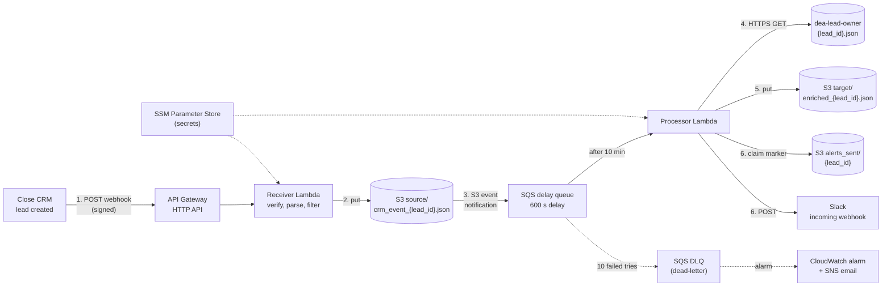

# LeadRelay: Real-Time CRM Lead Processing and Notification System

Captures new leads from Close CRM webhooks, waits 10 minutes for the CRM to assign a lead owner,
enriches each lead with its owner and stores it in Amazon S3, and alerts the sales team on Slack.

**Why "LeadRelay"?** In a relay race each runner hands the baton to the next and nobody drops it.
LeadRelay does the same with every new lead: Close creates it, we capture it, hold it 10 minutes,
add its owner, and hand it to the sales team on Slack, without dropping any lead along the way.

## Architecture



1. Close sends a signed webhook for every new lead to the API Gateway URL.
2. The **receiver** Lambda checks the signature, keeps only `lead` + `created` events and saves the raw event
   to `source/crm_event_{lead_id}.json`. It replies within Close's 15-second limit.
3. S3 notifies the **SQS delay queue**, which hides each message for 10 minutes, so the owner lookup can
   never happen early.
4. The **processor** Lambda looks up the owner in `dea-lead-owner`. If it isn't there yet, the message
   comes back every 5 minutes; on the 6th try the lead is alerted as UNASSIGNED.
5. The processor writes `target/enriched_{lead_id}.json`, then sends the Slack alert exactly once
   (an `alerts_sent/{lead_id}` marker written with an S3 conditional write).
6. A message that fails 10 times lands in the dead-letter queue (DLQ), and a CloudWatch alarm emails you.

Every lead has its own files, so any number of leads can be processed in parallel without races.
Details: [docs/architecture.md](docs/architecture.md).

## Documents

| Step | Document |
|---|---|
| 0 | [Requirements](docs/00_requirements/) |
| 1 | [Architecture](docs/architecture.md) |
| – | [Decisions and change log](docs/decisions.md) |

## Run it locally (no AWS needed)

Requires Python 3.13.

```bash
python3 -m venv .venv
.venv/bin/pip install -r requirements-dev.txt
.venv/bin/python -m pytest              # all unit tests (S3/SSM faked with moto, HTTP faked locally)
.venv/bin/python scripts/demo_local.py  # one lead end to end: receiver -> processor -> Slack message
```

## Code

| Module (`src/leadrelay/`) | Job |
|---|---|
| `receiver.py` | Lambda: Close webhook in, verify, filter, save to `source/` |
| `processor.py` | Lambda: delayed SQS message in, lookup, `target/`, alert once |
| `signature.py` | Close HMAC-SHA256 signature check |
| `storage.py` | S3 key names, JSON read/write, alert marker (conditional writes) |
| `lookup.py` | Owner lookup over HTTPS with timeout and backoff |
| `enrich.py` | Merge CRM event + owner into the enriched record |
| `alert.py` | Slack message format and send with retries |
| `config.py` | Settings from environment variables, secrets from SSM Parameter Store |

## Deploy to AWS (Terraform)

You need: an AWS account and the AWS CLI (Command Line Interface) logged in (`aws sts get-caller-identity`
works), Terraform 1.15+, and a Slack incoming webhook URL. Everything is created in us-east-1.

```bash
# 1. Where alarm emails go (git-ignored file)
printf 'alarm_email = "%s"\n' 'you@example.com' > infra/terraform.tfvars

# 2. Create everything (about 30 resources); review the plan, then type "yes"
cd infra && terraform init && terraform apply; cd ..
```

After the apply:

3. **Confirm the alarm email:** AWS sends "AWS Notification - Subscription Confirmation"; click its link.
4. **Store the secrets** in SSM (Systems Manager) Parameter Store. `terraform -chdir=infra output set_secrets`
   prints the two commands; each reads the secret from your keyboard, so it never lands in shell history.
5. **Give the webhook URL** (`terraform -chdir=infra output webhook_url`) to the Close admin, who creates the
   webhook subscription for `lead` `created` events and gives you its `signature_key` for step 4.

### Test it

```bash
.venv/bin/python scripts/send_test_lead.py --bad-signature   # expect 401: signature check works
aws logs tail /aws/lambda/leadrelay-receiver --since 10m --region us-east-1
aws logs tail /aws/lambda/leadrelay-processor --since 30m --region us-east-1
aws s3 ls s3://$(terraform -chdir=infra output -raw bucket_name)/target/ --region us-east-1
```

`send_test_lead.py` without `--bad-signature` only gets 200 while the SSM key equals `TEST_SIGNATURE_KEY`
in `.env` (before the real Close key is set). About 10 minutes after a lead is saved, its alert appears in Slack.

### Operate it

| Situation | What to do |
|---|---|
| Alarm email "leadrelay-dlq-not-empty" | Read the processor logs for that `lead_id`; fix the cause; redrive the DLQ from the SQS console |
| Close signature key rotated | Put the new key in SSM; the receiver picks it up within a minute, no restart |
| Slack webhook URL changed | Put the new URL in SSM, then force fresh Lambdas (any config change, or redeploy) |
| Code changed | `cd infra && terraform apply` (it zips and deploys `src/` again) |

### Tear it down

```bash
cd infra && terraform destroy; cd ..
```

This deletes everything, **including the bucket and every lead file in it** (`force_destroy = true`), the
queues, Lambdas, logs, alarm and secrets. Ask the Close admin to delete the webhook subscription too, or
Close keeps retrying a dead URL.
