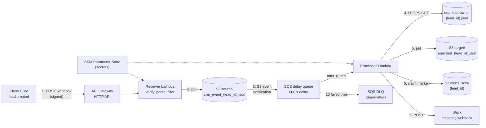

# LeadRelay architecture

How a new Close lead becomes a Slack alert. Decisions behind each choice: [decisions.md](decisions.md).
Requirements: [requirements.txt](00_requirements/requirements.txt).

## 1. Flow



One bucket, `leadrelay-{account_id}` (us-east-1), holds three prefixes:

| Prefix | Content | Written by |
|---|---|---|
| `source/crm_event_{lead_id}.json` | Raw webhook body (`subscription_id` + `event`), unchanged | Receiver |
| `target/enriched_{lead_id}.json` | Flat enriched record (7 alert fields + bookkeeping) | Processor |
| `alerts_sent/{lead_id}` | "Alert sent" marker (JSON status) | Processor |

## 2. Components

### 2.1 API Gateway (HTTP API)
- Public URL `POST /crm`, given to Azmat/Ninad for the Close webhook subscription.
- Payload format **1.0**: the event Lambda receives has the same shape as the sample in the
  requirements (`headers`, `body` as a JSON string, `isBase64Encoded`).
- HTTP API rather than REST API: cheaper and simpler; we need no REST API-only features.

### 2.2 Receiver Lambda (`receiver`)
Must reply within **15 s** (Close's limit) and never wait for anything slow.

1. Read `body` (decode base64 first if `isBase64Encoded` is true). Keep the **raw string**: the
   signature is computed over it exactly as received.
2. **Verify the signature:** `HMAC-SHA256(key = bytes.fromhex(signature_key),
   msg = Close-Sig-Timestamp + raw_body)`, hex digest, compared with `Close-Sig-Hash` using
   `hmac.compare_digest`. Reject if the timestamp is more than 5 minutes old (stops replays).
3. Parse with `json.loads`. Keep only `event.object_type == "lead"` and `event.action == "created"`.
4. Write the parsed body to `source/crm_event_{lead_id}.json`.

| Situation | Reply | Effect |
|---|---|---|
| Saved | 200 | Done |
| Not a lead-created event | 200 | Ignored, logged at INFO |
| Bad or missing signature / old timestamp | 401 | Logged at WARNING, nothing saved |
| Body not JSON or `lead_id` missing | 400 | Logged at ERROR, nothing saved |
| S3 write fails | 500 | Close retries (backoff, up to 72 h) |

### 2.3 S3 event notification → SQS delay queue
- Notification on `s3:ObjectCreated:*` with filter prefix `source/`, suffix `.json`.
- Queue (standard, not FIFO; S3 cannot send to FIFO queues):
  - `DelaySeconds = 600`: every new message is invisible for 10 minutes. This is the only thing
    that enforces "lookup after the delay, never before".
  - `VisibilityTimeout = 300`: a message that fails processing comes back 5 minutes later.
  - Queue policy lets only our bucket (`aws:SourceArn`) send to it.
- Dead-letter queue (DLQ): `maxReceiveCount = 10`. After 10 failed tries the message moves there
  and is kept 14 days for a human to inspect and redrive.
- When the notification is first configured, S3 sends one `s3:TestEvent` message: the processor
  ignores it.

### 2.4 Processor Lambda (`processor`)
Triggered by the queue (event source mapping, **batch size 1**: one lead per invocation, so one
lead's failure never retries another's). Timeout 30 s (visibility timeout 300 s is above the
6× timeout AWS recommends).

1. Read the S3 key from the message (`unquote_plus`), extract `lead_id`. Ignore `s3:TestEvent`.
2. Read `source/crm_event_{lead_id}.json`. Check required fields: `lead_id`, `display_name`,
   `date_created`, `status_label`. Missing → raise (fail loudly) → retried, then DLQ.
3. **Look up the owner:** `GET https://dea-lead-owner.s3.us-east-1.amazonaws.com/{lead_id}.json`,
   timeout 5 s.
   - Network error / 5xx: retry in-process 3 times with backoff (1 s, 2 s), then raise.
   - 403 / 404: owner not there yet, no in-process retry (see 2.5).
   - File's `lead_id` differs from ours: raise (data error).
4. Build the enriched record and write `target/enriched_{lead_id}.json`.
5. Send the alert exactly once (see section 4).

### 2.5 Missing owner policy (decided: retry, then alert as UNASSIGNED)
Uses the message's `ApproximateReceiveCount` (how many times SQS has delivered it):

| Try | Owner found? | Action |
|---|---|---|
| any | yes | Enrich, alert with the owner |
| 1–5 | no | Raise "owner not assigned yet" → message returns in 5 min |
| 6 | no | Enrich with owner fields `null`, `owner_found: false`; alert with `Lead Owner: UNASSIGNED`; log WARNING |

Timeline: try 1 at minute 10, try 6 at about minute 35. `maxReceiveCount = 10` is above 6, so
the DLQ receives only real errors (Slack down, bad data), never "owner missing".
Settings: `OWNER_MAX_TRIES = 6` (Lambda environment variable), visibility timeout 300 s.

### 2.6 Slack alert
Incoming webhook URL from SSM Parameter Store. Message text (Slack `mrkdwn`):

```
:rotating_light: *New Lead Alert*
*Name:* {display_name}            ← CRM event
*Lead ID:* {lead_id}              ← CRM event
*Created Date:* {date_created}    ← CRM event
*Label:* {status_label}           ← CRM event
*Email:* {lead_email}             ← lookup
*Lead Owner:* {lead_owner}        ← lookup ("UNASSIGNED" if missing)
*Funnel:* {funnel}                ← lookup
```

| Slack reply | Action |
|---|---|
| 200 | Done |
| 429 (rate limit), 5xx | Retry in-process with backoff; still failing → raise (SQS retries) |
| 4xx other (bad/revoked URL) | Raise, log ERROR (config problem, ends in DLQ) |

### 2.7 Secrets: SSM Parameter Store
| Parameter (SecureString) | Used by |
|---|---|
| `/leadrelay/close_signature_key` | Receiver |
| `/leadrelay/slack_webhook_url` | Processor |

Free (standard tier), encrypted. Terraform creates each parameter with a placeholder and ignores
later value changes; the user sets the real values with the AWS CLI, so secrets never enter git or
Terraform files. Lambdas read them once per cold start and cache them.

## 3. Enriched record (`target/enriched_{lead_id}.json`)

```json
{
  "lead_id": "lead_Q6uq...",
  "display_name": "Adam Capozzoli",
  "date_created": "2025-09-04T07:27:17.642000+00:00",
  "status_label": "Potential",
  "lead_email": "adam@example.com",
  "lead_owner": "Lucija Bitunjac",
  "funnel": "DE ACADEMY Direct VSL",
  "owner_found": true,
  "enriched_at": "2026-11-11T12:40:00+00:00",
  "source_key": "source/crm_event_lead_Q6uq....json"
}
```

Name, Lead ID, Created Date and Label always come from the CRM event; Email, Lead Owner and Funnel
from the lookup (the requirements say so, even though the lookup file repeats some fields).

## 4. Duplicates, parallelism and idempotency

Duplicates can enter at three points: Close retries a webhook, S3 sends a notification twice,
SQS delivers a message twice. Each step is safe to repeat:

| Step | Repeat-safe because |
|---|---|
| Raw write | Same key `source/crm_event_{lead_id}.json` → overwrite, still one file |
| Enriched write | Same key `target/enriched_{lead_id}.json` → overwrite |
| Alert | Marker protocol below |

**Alert marker protocol** (`alerts_sent/{lead_id}`):
1. Claim: create the marker with `{"status": "sending", "at": now}` using an S3 **conditional
   write** (`IfNoneMatch="*"`: succeeds only if the object does not exist). Atomic: if two
   copies race, exactly one wins.
2. Claim won → send to Slack → overwrite marker with `{"status": "sent", "at": now}`.
   Slack fails → delete the marker, raise (SQS retries).
3. Claim lost → read the marker:
   - `sent` → skip (duplicate), log INFO.
   - `sending` and newer than 2 minutes → another copy is mid-send: raise, retry later.
   - `sending` and older than 2 minutes → that copy crashed mid-send: take over and send. The take-over
     is also a conditional write (`IfMatch=<ETag read>`), so if two copies find the same stale marker,
     only one takes over.
     (A crash *after* Slack accepted but before the marker update can cause one duplicate alert:
     accepted, because the alternative is a lost alert.)

**Parallelism / race conditions:** every lead has its own keys, its own SQS message and its own
marker, so many leads in flight never touch shared state. Lambda runs one invocation per message
in parallel. Slack's webhook limit (about 1 message per second) is handled by the 429 retry.

## 5. Logging and monitoring
- JSON log lines to CloudWatch Logs, every line carries `lead_id` and the step
  (`receive`, `lookup`, `enrich`, `alert`). Log retention 14 days.
- Levels: INFO normal flow, WARNING unassigned owner / bad signature, ERROR failures.
- Step 6 (hardening) adds a CloudWatch alarm when the DLQ holds any message.

## 6. Code layout (Step 2)

```
src/leadrelay/
├── receiver.py      Lambda handler: webhook in → S3 source/
├── processor.py     Lambda handler: SQS message → lookup → target/ → alert
├── signature.py     Close signature check
├── storage.py       S3 reads/writes, conditional marker write
├── lookup.py        owner lookup over HTTPS (timeout, retries)
├── enrich.py        merge CRM event + owner → enriched record
├── alert.py         format + send Slack message
└── config.py        settings and SSM secrets
tests/               pytest, no AWS (S3 faked with moto, HTTP faked locally)
infra/               Terraform (Step 3)
```

Standard library only at runtime (`urllib`, `json`, `hmac`) plus `boto3`, which the Lambda Python
runtime already includes, so the deployment package is a plain zip with no dependencies.

## 7. Open questions (for Azmat/Ninad)
1. Does `dea-lead-owner` still hold files? Sample lead_ids return HTTP 403 (checked 2026-11-04
   and 2026-11-10). How soon after lead creation does an owner file appear? (Tunes `OWNER_MAX_TRIES`.)
2. The Close `signature_key` for our subscription (returned when they create it).
3. Are occasional duplicate alerts acceptable (see section 4)?
4. Which Slack channel should receive alerts?
